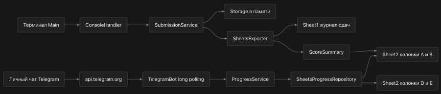

## Point track
Консольное Java-приложение для ведения академической успеваемости потока по предмету ООП.
Проект создан в рамках учебного задания. Предназначен для учета количества сданных задач и просмотра набранных баллов.



### Сборка
1. Проверьте, что у вас JDK 26
2. `git clone https://github.com/zxffg/urfu-point-track`
3. `mvn compile` или используйте IDE IntelliJ
4. Настройте переменные окружения (см. раздел ниже) до запуска, иначе программа завершится с сообщением о недостающих переменных
5. Запустите класс `Main`

### Настройка API

1. Создай проект в [Google Cloud Console](https://console.cloud.google.com)
2. Включи Google Sheets API: в меню APIs & Services → Library, найди "Google Sheets API", нажми Enable
3. Создай Service Account: Credentials → Create Credentials → Service Account
4. Открой созданный Service Account → вкладка Keys → Add Key → Create new key → выбери JSON. Файл скачается автоматически (**обязательно добавь его в `.gitignore`, это фактически пароль**)
5. Открой нужную Google таблицу → кнопка "Настройки доступа" / Share → вставь email Service Account (вида `xxx@yyy.iam.gserviceaccount.com`, виден в настройках Service Account) → дай права "Редактор"

Без шага 5 API будет отвечать 403 Forbidden, даже если всё остальное настроено верно.

### Переменные окружения

Приложению нужны две переменные окружения:

| Переменная | Значение |
|---|---|
| `SHEETS_CREDENTIALS_PATH` | Полный путь до скачанного JSON-ключа Service Account |
| `SHEETS_SPREADSHEET_ID` | ID таблицы из её URL: `docs.google.com/spreadsheets/d/ВОТ_ЭТОТ_КУСОК/edit` |

**Через IntelliJ:** Run → Edit Configurations → выбери конфигурацию запуска `Main` → поле Environment variables → добавь обе переменные через точку с запятой:

```
SHEETS_CREDENTIALS_PATH=/полный/путь/до/credentials.json;SHEETS_SPREADSHEET_ID=твой_id_таблицы
```

**Через терминал (действует только на текущую сессию):**

```bash
export SHEETS_CREDENTIALS_PATH=/полный/путь/до/credentials.json
export SHEETS_SPREADSHEET_ID=твой_id_таблицы
```

Если переменные не заданы, программа выводит сообщение об этом и завершает работу, не пытаясь подключиться к API.

Названия всех диапазонов, листов и ячеек обьявлено в `sheets/SheetLayout`. Настроить вывод и взаимодействие с таблицей можно полностью через этот файл.

### Telegram: токен и админы

1. Создай бота у [@BotFather](https://t.me/BotFather) командой `/newbot` и скопируй токен.
2. Задай переменные окружения:

| Переменная | Значение |
|---|---|
| `TELEGRAM_BOT_TOKEN` | токен от BotFather |
| `TELEGRAM_ADMIN_IDS` | числовые Telegram ID админов через запятую, например `123456,789012` |

Свой ID можно узнать у [@userinfobot](https://t.me/userinfobot). Без `TELEGRAM_ADMIN_IDS` админ-команды (`/group`, `/recalculate`, `/add_submission`, `/delete_submission`) недоступны.

IntelliJ: Run → Edit Configurations → Environment variables:

```text
TELEGRAM_BOT_TOKEN=123456:AA...;TELEGRAM_ADMIN_IDS=123456,789012