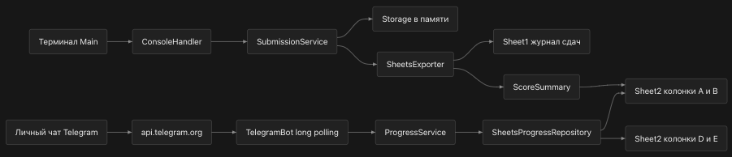

## Point track
Консольное Java-приложение для ведения академической успеваемости потока по предмету ООП.
Проект создан в рамках учебного задания. Предназначен для учета количества сданных задач и просмотра набранных баллов.



### Сборка
1. Проверьте, что у вас JDK 26
2. `git clone https://github.com/zxffg/urfu-point-track`
3. `mvn compile` или используйте IDE IntelliJ
4. Настройте переменные окружения (см. раздел ниже) до запуска, иначе программа завершится с сообщением о недостающих переменных
5. Запустите класс `Main`

### Список реализованного (Пункт будет здесь, до написания первой рабочей версии)
- [x] Пакет `storage` содержит три класса: [`Exercise`](src/main/java/storage/Exercise.java), [`Submission`](src/main/java/storage/Submission.java) и [`Team`](src/main/java/storage/Team.java)
  (подробнее в комментариях к коду).
- [x] `Storage` хранит записи `Submission` и задания `Exercise`, умеет искать или создавать задание по имени (`findOrCreateEx`) и находить запись по id (`getByID`)
- [x] `ConsoleHandler` консольное меню с внесением результатов и просмотром всех записей
- [x] Интеграция с Google Sheets через `SheetsExporter` (интерфейс `ResultsExporter`), каждая новая запись сразу отправляется в таблицу
- [x] Обработка дубликатов (та же команда плюс то же задание)
- [x] Полное покрытие тестами (`Storage`, `ConsoleHandler`)

### Настройка API

1. Создай проект в [Google Cloud Console](https://console.cloud.google.com)
2. Включи Google Sheets API: в меню APIs & Services → Library, найди "Google Sheets API", нажми Enable
3. Создай Service Account: Credentials → Create Credentials → Service Account
4. Открой созданный Service Account → вкладка Keys → Add Key → Create new key → выбери JSON. Файл скачается автоматически (**обязательно добавь его в `.gitignore`, это фактически пароль**)
5. Открой нужную Google таблицу → кнопка "Настройки доступа" / Share → вставь email Service Account (вида `xxx@yyy.iam.gserviceaccount.com`, виден в настройках Service Account) → дай права "Редактор"

Без шага 5 API будет отвечать 403 Forbidden, даже если всё остальное настроено верно.

### Переменные окружения

Приложению нужны две переменные окружения:

| Переменная | Значение |
|---|---|
| `SHEETS_CREDENTIALS_PATH` | Полный путь до скачанного JSON-ключа Service Account |
| `SHEETS_SPREADSHEET_ID` | ID таблицы из её URL: `docs.google.com/spreadsheets/d/ВОТ_ЭТОТ_КУСОК/edit` |

**Через IntelliJ:** Run → Edit Configurations → выбери конфигурацию запуска `Main` → поле Environment variables → добавь обе переменные через точку с запятой:

```
SHEETS_CREDENTIALS_PATH=/полный/путь/до/credentials.json;SHEETS_SPREADSHEET_ID=твой_id_таблицы
```

**Через терминал (действует только на текущую сессию):**

```bash
export SHEETS_CREDENTIALS_PATH=/полный/путь/до/credentials.json
export SHEETS_SPREADSHEET_ID=твой_id_таблицы
```

Если переменные не заданы, программа выводит сообщение об этом и завершает работу, не пытаясь подключиться к API.

Название листа внутри таблицы, куда пишутся данные, задано в коде как `Sheet1`. Если вкладка листа в твоей таблице называется иначе (например `Лист1`), поменяй значение в `SheetsExporter.export()`.

### Тесты
Тесты написаны на JUnit 5, лежат в `src/test/java`.
```bash
mvn test
```

### Telegram-бот

Бот читает Google Sheets, а не таблицу локально на компьютере. Лист 'Sheet2' содержит сводку: A1 `Студент`, B1 `Баллы`, далее по одной строке на студента. В D1 `Студент`, E1 `Telegram`, далее соответствие имени студента и username (с @ или без). Имена в A и D должны совпадать и быть уникальными. Сводку в A:B нужно заполнить или вычислить формулами самостоятельно; бот ее только читает. Лист `Sheet1` содержит три фамилии, задание, дедлайн, результат в A:F. При переходе со старого формата, где результат был в E, перенесите старые результаты в F.

1. Создайте бота через BotFather, получите токен и предоставьте service account доступ к таблице по инструкции выше.
2. Помимо переменных Sheets задайте `TELEGRAM_BOT_TOKEN`. `TELEGRAM_ADMIN_IDS` содержит числовые Telegram ID администраторов через запятую, например `123456,789012`. Без него команда администратора недоступна. ID можно узнать с помощью `@userinfobot` бота Telegram.
3. Необязательная `SHEETS_SUMMARY_NAME` задает название второго листа (по умолчанию `Sheet2`). Для HTTP-прокси задайте обе переменные `TELEGRAM_PROXY_HOST` и `TELEGRAM_PROXY_PORT`. Прокси используется только для Telegram, без авторизации; если переменные не заданы, подключение прямое.
4. Запустите `BotMain` из IDE с теми же зависимостями Maven. Консольную программу `Main` можно запускать отдельно. Для long polling отключите ранее настроенный webhook и запускайте только один экземпляр бота с этим токеном.

Команды в личном чате: `/points` показывает баллы, `/group` показывает сводку администраторам, `/help` показывает справку. Таблица читается при каждом запросе. Username может измениться или перейти другому пользователю, поэтому такая схема не гарантирует конфиденциальность оценок: своевременно обновляйте список или используйте привязку по неизменяемому числовому Telegram ID до работы с конфиденциальными данными. Не публикуйте токен и ключ service account.