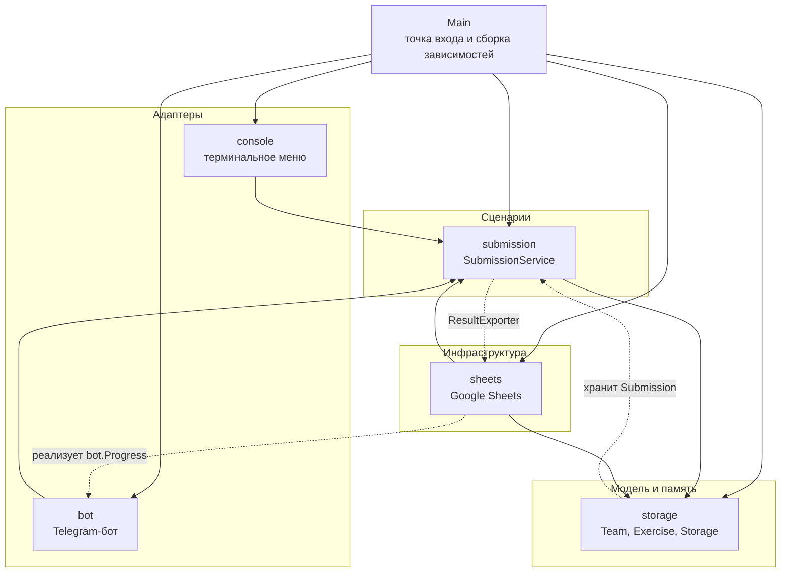

# Point Track
Java-приложение для ведения академической успеваемости учащихся.
Позволяет вносить результаты сдачи задач (команда, задание, баллы), хранить их локально и автоматически отправлять в Google Sheets.

Взаимодействие с кодом осуществленно по средствам терминала, телеграм бота и совместного режима.

Данный репозиторий является учебным заданием по курсу ООП в УрФУ 2026.

1. [Возможности](#возможности)
2. [Быстрый старт](#быстрый-старт)
3. [Структура проекта](#структура-проекта)

## Возможности
- Внесение результатов через консоль и телеграм бота
- Валидация ввода (размер команды, баллы, даты)
- Поиск или создание задания по имени (валидация дублей)
- Просмотр всех внесённых записей
- Удаление последних записей через консоль и телеграм бота (с подтверждением)
- Автоматическая синхронизация с Google Sheets через Service Account

## Быстрый старт

```bash
git clone https://github.com/zxffg/urfu-point-track
cd urfu-point-track
mvn clean install
```

Настройка Google Sheets API, Telegram Bot Token и  переменных окружения описана в [DEVELOPER.md](DEVELOPER.md).

## Структура проекта

### Пакеты



```text
src/main/java
├── Main.java                          // точка входа: env, выбор режима, сборка зависимостей
│
├── storage/                           // модель предметной области и память
│   ├── Team.java                      // команда из 1–3 фамилий
│   ├── Exercise.java                  // задание: название + дедлайн
│   └── Storage.java                   // List<Submission>, проверка дублей, nextId, getByID, remove
│
├── submission/                        // сценарии работы с записями
│   ├── Submission.java                // record: id, team, exercise, score
│   └── SubmissionService.java         // createSubmission, deleteSubmission, getAllSubmissions, rewriteSummary
│
├── sheets/                            // всё, что знает про Google Sheets
│   ├── ResultExporter.java            // интерфейс: export / deleteSubmission / rewriteSummary
│   ├── SheetsExporter.java            // append, deleteDimension, пересчёт Sheet2
│   ├── SheetsProgressRepository.java  // чтение Sheet1/Sheet2, реализует bot.Progress
│   ├── SheetLayout.java               // имена листов и диапазоны
│   ├── ScoreCalculator.java           // сумма баллов по фамилиям
│   └── StudentScore.java              // record для сводки внутри sheets
│
├── bot/                               // Telegram-адаптер
│   ├── PointBot.java                  // long polling, маршрутизация, клавиатуры
│   ├── ProgressService.java           // команды, права, состояния добавления/удаления
│   ├── BotCommand.java                // enum команд и парсинг текста
│   ├── SubmissionDialog.java          // пошаговое добавление записи
│   ├── DialogState.java               // состояния добавления
│   ├── Progress.java                  // интерфейс чтения сводки
│   ├── StudentScore.java              // record для отчёта бота
│   └── TelegramAccount.java           // фамилия + username
│
└── console/                           // терминальный адаптер
    ├── ConsoleHandler.java            // меню 1–4: добавить / показать / пересчитать / удалить
    ├── MenuOption.java                // пункты меню терминала
    ├── ChoiceMode.java                // выбор режима запуска
    └── ModeOption.java                // режимы: терминал / бот / гибрид
```

```text
src/main/resources
├── 3-task-structure.png
├── credentials-example.json         // пример ключей Google
└── telegram-bot-example.json        // пример токена и списка админов
```

### Кто за что отвечает

| Пакет | Ответственность | Ключевые классы |
|---|---|---|
| `storage` | модель и in-memory хранилище | `Team`, `Exercise`, `Storage` |
| `submission` | сценарии создания и удаления записей | `Submission`, `SubmissionService` |
| `sheets` | интеграция с Google Sheets | `ResultExporter`, `SheetsExporter`, `SheetsProgressRepository`, `SheetLayout`, `ScoreCalculator` |
| `bot` | Telegram UI и состояния диалогов | `PointBot`, `ProgressService`, `BotCommand`, `SubmissionDialog` |
| `console` | терминальное меню | `ConsoleHandler`, `MenuOption`, `ChoiceMode`, `ModeOption` |
| `Main` | composition root: собирает всё вместе | `Main` |

Тесты (JUnit 5) лежат в `src/test/java` и покрывают модель, `Storage`, `SubmissionService`, диалоги бота, команды и расчёт итогов.

Подробности по каждому классу - в комментариях к коду.

## Статус

Проект в разработке. Актуальный список готового находится в [DEVELOPER.md](DEVELOPER.md).